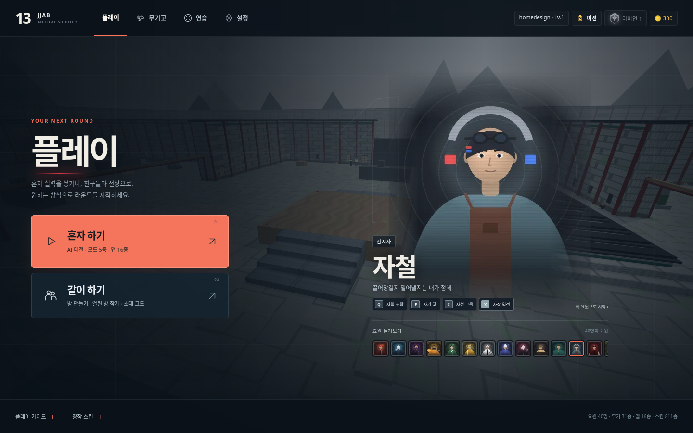
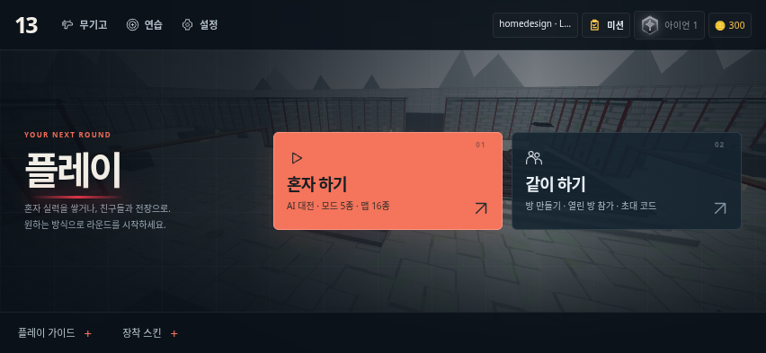

# 홈 배치와 참고

홈을 플레이 선택·요원·보조 기능이 구분되는 FPS 로비로 정리했습니다. 기존 기능과 게임의 요원 그림을 사용합니다.

## 확인한 사례

- [VALORANT 5.10 공식 메뉴 변경 기록](https://playvalorant.com/en-us/news/game-updates/valorant-patch-notes-5-10/): 주요 화면의 한 번 클릭 이동을 상단 공통 내비게이션에 복구했다고 설명합니다. 무기고·연습·설정을 상단에서 바로 접근하도록 참고했습니다.
- [VALORANT 메뉴 화면 — Interface In Game](https://interfaceingame.com/screenshots/valorant-main-menu/): 상단 화면 이동, 계정·소셜 영역, 중앙의 큰 게임 비주얼을 분리한 구성을 확인했습니다.
- [Overwatch 2 메뉴 화면 — Interface In Game](https://interfaceingame.com/screenshots/overwatch-2-main-menu/): 왼쪽의 명확한 플레이/보조 메뉴와 중앙 캐릭터, 오른쪽 위 계정을 분리한 구성을 확인했습니다.

공식 기록과 공개된 과거 화면을 참고한 배치 분석입니다. 최신 버전의 전체 UI를 조사했다는 의미는 아닙니다. 타사 게임의 이미지·로고·이벤트를 이 게임에 가져오지 않았습니다.

## 이 게임에 적용

- 상단: 작은 13/JJAB 로고, 현재 플레이 화면, 무기고·연습·설정, 계정·미션·랭크·골드.
- 왼쪽: 플레이 제목, 혼자 하기/같이 하기, 유효한 최근 설정. 기존처럼 요원/맵/모드는 선택 화면에서 고릅니다.
- 오른쪽: 기존 요원 그림·이름·능력, 해당 요원 시작과 가로 요원 목록. 요원 칩을 키보드로도 선택할 수 있습니다.
- 하단: 플레이 가이드와 장착 스킨을 펼쳐 확인. 안내 문단을 주 버튼 사이에서 제거하고, 중복 안내 카드는 숨깁니다. 도움말은 화면 경계 안의 팝업에서 읽고 닫습니다.
- 모바일 가로: 요원 그림을 만들지 않고 두 플레이 버튼을 나란히 표시. 상단 메뉴와 계정, 하단 도움말을 유지합니다.
- 모바일 세로: 계정과 화면 이동을 두 줄로 구분하고 두 플레이 버튼을 유지합니다.
- 색/형태: 어두운 청회색 배경, 따뜻한 코랄 플레이 버튼, 작은 모서리, 얇은 구분선, 글자 크기 차이로 우선순위를 표시. 기존 3D 맵 배경과 저사양/모션 줄이기 설정을 사용합니다.

## 소스

`css/home-lobby.css`는 홈 전용 스타일이며 초기 화면부터 적용합니다. `js/home-layout.js`는 기존 버튼/패널을 재배치하고 다국어 표시와 팝업 경계를 관리합니다. 경기 입력·계정·보상은 이 파일에서 변경하지 않습니다. `css/mobile.css`에는 전투 버튼 배치만 남겨 홈의 이전 레이아웃과 충돌을 줄였습니다.

검사 명령: `npm run test:lobby`. 화면별 스크린샷은 기본 `/tmp/dfdf-lobby`, `DFDF_SCREENSHOT_DIR`로 출력 위치를 지정할 수 있습니다. 실제 모바일 기기 사용성은 별도입니다.

## 미리보기

실행 중인 게임에서 촬영한 화면입니다. 테스트용 계정과 로컬 API 응답을 사용했습니다.

[작은 가로 화면](previews/home-design-small.png) · [세로 화면](previews/home-design-portrait.png) · [가이드 팝업](previews/home-design-help.png)
