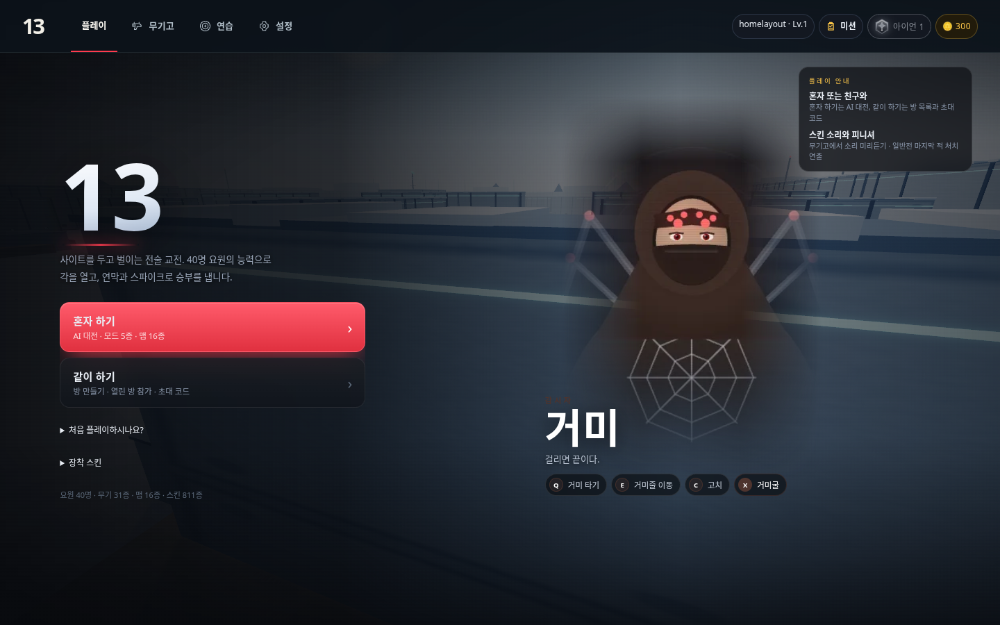
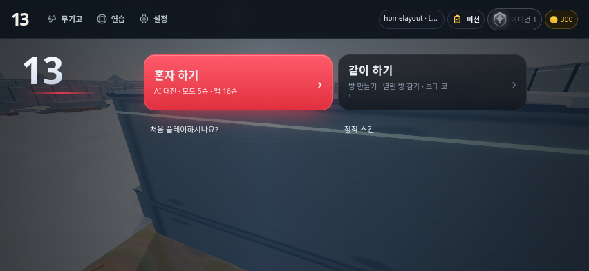

# 원래 홈 디자인과 상단 메뉴

사용자가 승인한 상단 무기고·연습·설정·계정 메뉴를 유지했습니다. 플레이 버튼의 빨간 그라데이션·둥근 모서리, 큰 13 로고, 요원 사진·글꼴·능력 표시, 배경과 기존 안내는 디자인 변경 전 상태로 복원했습니다. 돈·티어·레벨·미션 칩도 원래 둥근 모양·배경·테두리·색상으로 유지합니다.

본문은 메뉴 너비·간격, 요원 영역 크기, 상단 여백만 조정합니다. 모바일 가로에서는 기존 두 플레이 버튼을 나란히 유지하고, 세로에서는 상단 계정/메뉴를 두 줄로 배치합니다. 첫 접속 무기고 버튼과 초상화 로딩 개선은 유지합니다. 중앙의 큰 13 아래와 왼쪽 위의 `JJAB / TACTICAL SHOOTER` 문구는 요청에 따라 제거하고 숫자 13은 유지합니다.

- `css/home-navigation.css`: 상단 메뉴 스타일과 본문 배치 치수.
- `js/home-navigation.js`: 기존 계정/보조 메뉴를 상단으로 이동하고 연습 선택 뒤 닫기.
- `npm run test:home-layout`: 1440×900, 1024×768, 852×393, 568×320, 390×844의 원래 버튼·로고·요원·계정 칩 스타일 일치, 가로 넘침/버튼 겹침, 연습·설정·무기고·같이 하기 실제 클릭 검사 통과.
- API 테스트 저장소와 로컬 Chromium을 사용했으며 실기기 검증과는 별개입니다.

## PC

## 모바일 가로

