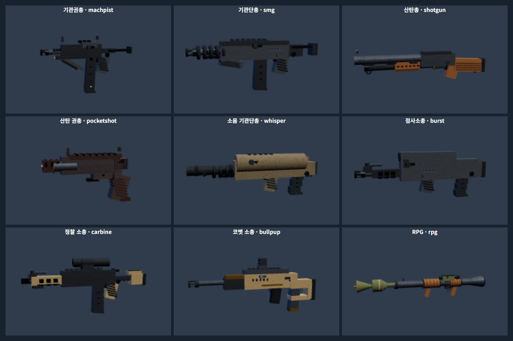
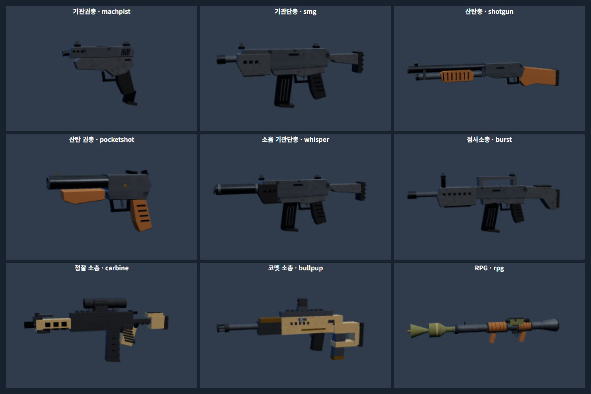

# 초기 제작 총기 6종 개편

총 18종+별도 칼을 유지한다. ‘제공한 총’의 원본 모델을 바꾼 작업이 아니다. 원본 JAR/팩 자산·텍스처·애니메이션은 수정하지 않았다.

## 전후 화면

전: 

후: 

위 화면의 마지막 줄 정찰 소총·코멧·RPG는 비교용으로 함께 찍었으며 보존했다. 고정 카메라의 축소 썸네일이므로 인게임 크기 차이로 해석하지 않는다.

## 총별 변경

| 총/키 | 원시 메시 전→후 | 후 삼각형 | 세부 변경 |
| --- | --- | --- | --- |
| 기관권총 / machpist | 77→41 | 840 | 상자형 기관권총을 경사진 프레임·슬라이드·손잡이·연장 탄창을 갖는 자동권총으로 변경. 슬라이드 홈·배출구·조준기·보상기 표현. |
| 기관단총 / smg | 91→58 | 1152 | 연결된 짧은 리시버·덮인 전방 손잡이·앞 탄창·개머리판으로 재구성. 총열 주변의 독립 링을 제거하고 조준기 받침을 연결. |
| 소음 기관단총 / whisper | 77→59 | 1200 | 다른 PDW 위에 소음기를 겹친 방식에서 독립 모델로 변경. 일체형 소음기·고정 칼라·긴 개머리판으로 기본 SMG와 구분. |
| 산탄총 / shotgun | 51→33 | 892 | 장총열·탄관·총열 밴드·목재 개머리판을 연결. 펌프 손잡이가 장전 끝에 실제로 뒤로 갔다가 복귀. |
| 산탄 권총 / pocketshot | 78→28 | 980 | 기존 핸드캐논에 총열을 덧붙이던 방식 제거. 쌍열·힌지·잠금 레버·목재 앞손잡이/그립으로 구성. 장전 때 총열/앞손잡이가 함께 꺾임. |
| 점사소총 / burst | 86→63 | 1228 | 긴 상자형 불펍에서 앞 탄창·지지된 운반 손잡이·전방 조준탑·통풍 손덮개·개머리판을 가진 소총으로 재구성. 3점사 규칙 유지. |

6종 합계 원시 메시 **460→282(약 38.7% 감소)**. 부품 수 수치이며 실제 draw call/FPS 개선율이 아니다. 실시간 뷰모델은 손·장전 소품을 포함하고 재질별로 병합되므로 원시 메시와 개수가 다르다.

## 구현 계약

- 새 파일 `js/legacy-gun-models.js`가 선택한 6개 builder만 교체한다. 기본 재질 분류를 사용해 기존 스킨 무늬/색을 적용한다.
- 폭은 X, 높이는 Y, 전방은 -Z. 베벨된 측면 윤곽을 만들어 부품이 따로 떠 보이지 않게 연결한다.
- 탄창 본체·바닥판·홈을 같은 장전 그룹에 넣었다. 실제 탄창이 있는 권총에 가짜 탄창 소품을 중복 생성하지 않는다.
- 산탄 권총 꺾임 최대 0.55rad, 산탄총 펌프 이동 최대 0.065 모델 단위. 종료/취소 뒤 변환이 복원된다. 이 값은 게임 피해/연사 수치가 아니다.
- 최초 구축 뒤 기존 뷰모델/다른 사람 무기/바닥 드롭/미리보기/구매창 경로를 사용한다. 네트워크 키와 보유 스킨을 바꾸지 않는다.

## 보존 범위

제공 팩: 클래식·고스트·셰리프·밴달·팬텀·저지·오딘·아웃로·오퍼레이터. 챔피언스 공격/수비는 팬텀(`scout`) 전용. 기존 정찰 소총(`carbine`)과 코멧(`bullpup`), RPG, 칼 원본도 그대로다. 팬텀 자동 연사/점사소총 3점사/정찰 단발·스코프가 뒤바뀌지 않게 기존 회귀를 실행한다.

## 검증 경로

`test:legacy-models`는 실제 브라우저에서 6종 기하의 유한성/비율/미리보기/월드 템플릿/원본 builder 보존/탄창 일체 이동/꺾임·펌프 복귀를 검사한다. `test:reload`, `test:weapon-shop`, `test:rifle-identity`, `test:valorant`, `test:valorant-inspect`, `test:valorant-scopes`도 전체 실행 범위에 포함한다. 원본 자산 바이트 검증은 기존 단위 검사에서 수행한다.

인게임 이미지는 임시 계정·AI 정지·고정 카메라로 외형을 확인한 캡처다. 경기 보상·탄약 UI 수치·실기기 FPS 검증 자료로 해석하지 않는다. 실제 Android의 시야/손 위치/장시간 성능 평가는 별도다.

