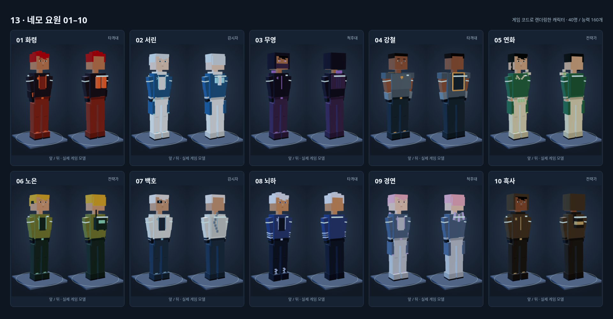
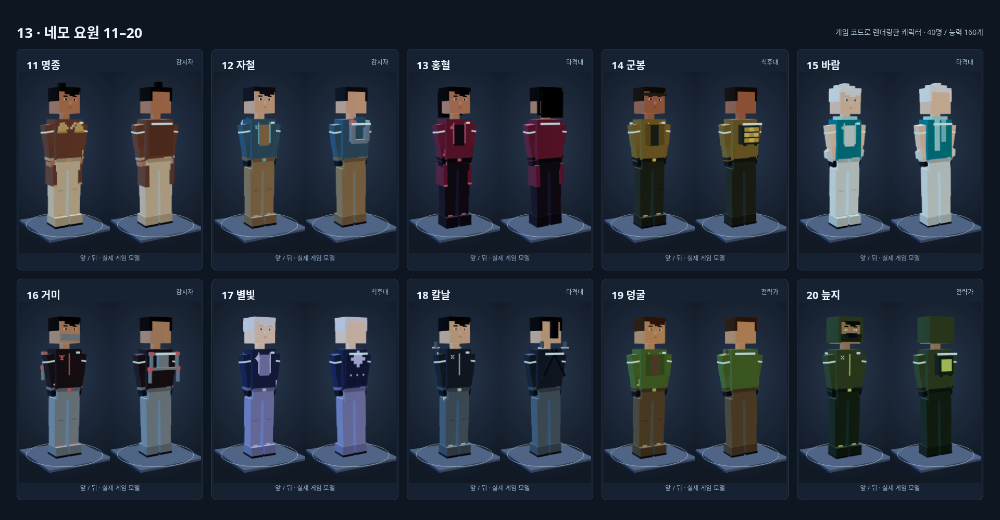
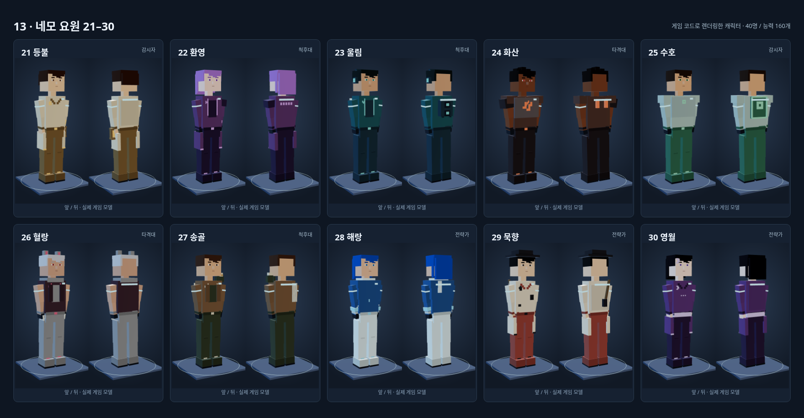
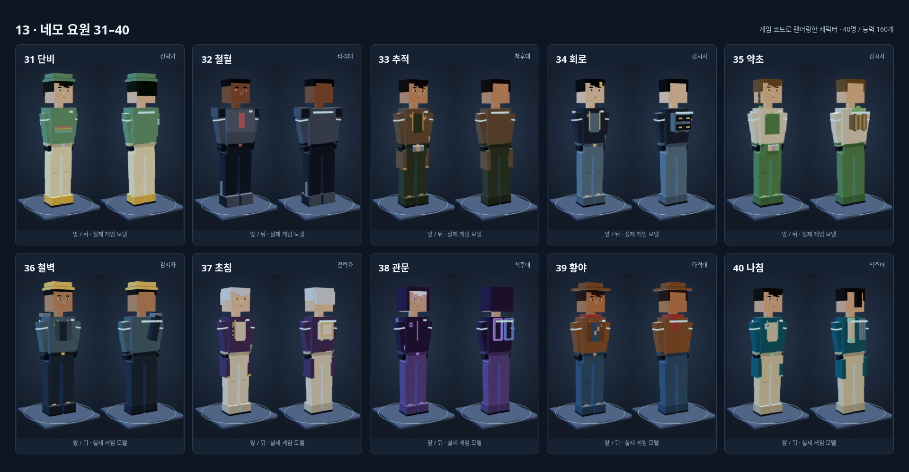

# 게임에 적용한 네모 캐릭터 — 40명

사용자가 지정한 방향은 **마크 느낌의 네모난 형태에 능력별 특징이 잘 보이는 캐릭터**입니다. 머리·몸통·팔·다리는 각진 블록으로, 얼굴은 단순한 네모 눈·눈썹·코·입으로 만들었습니다. 재킷·겹옷·갑옷의 큰 색 면을 나누고 캐릭터마다 알아볼 수 있는 장비를 붙였습니다.

`js/agent-voxel.js`가 최종 40명 목록 뒤에서 실제 `CH_OUTFIT`/`buildFighter`에 적용합니다. 실제 경기의 요원, 홈 대표 이미지, 요원 선택과 대기실 초상화에서 같은 외형을 사용합니다. `/play.html?model-review=1`에서 40명 선택, 앞·뒤 회전과 기존 사격·달리기·재장전 동작을 볼 수 있습니다.

## 능력과 외형

| 요원 | 크게 보이는 특징 |
|---|---|
| 화령 | 화염 장갑, 주황 열 카트리지, 불꽃 가슴 문양 |
| 서린 | 얼음 덫, 파란 방한 코트, 등 서리 결정 |
| 무영 | 보라 두건과 마스크, 등에 꽂힌 정찰 화살 |
| 강철 | 등에 접힌 방패, 양손 강철 장갑, 넓은 어깨 |
| 연화 | 꽃잎 모양 블록 어깨, 회복 씨앗, 비취 겹옷 |
| 노은 | 전파 배낭, 감시 장치 수납부, 귀 수신기 |
| 백호 | 흰 망토, 한쪽 관측 렌즈, 계단 모양 활 |
| 뇌하 | 손목 코일, 번개 문양 장화, 파란 전도판 |
| 경연 | 등에 정렬한 다섯 거울 조각, 손등 거울 |
| 흑사 | 모래 두건과 얼굴 천, 겹친 숄, 모래 용기 |
| 명종 | 두 개의 청동 종, 네모 공명 장치, 손목 릴 |
| 자철 | ㄷ자 자석과 양 극 표시, 자기 닻 작업복 |
| 홍혈 | 진홍 코트, 피 채찍 손목 띠, 혈액 코어 |
| 군봉 | 노랑 벌집 배낭, 격납 칸, 얼굴 보호 띠 |
| 바람 | 청록 스카프, 전완의 작은 기류 날개 |
| 거미 | 접힌 거미 다리 네 개, 마스크와 추가 눈, 거미줄 릴 |
| 별빛 | 등에 붙인 네모 별 코어, 별무늬 망토 |
| 칼날 | 교차한 칼집, 표식 단검, 경량 검은 전투복 |
| 덩굴 | 블록 잎 어깨, 팔의 덩굴, 가시 말뚝 주머니 |
| 늪지 | 방독면, 녹색 독액 탱크, 낮은 두건 |
| 등불 | 허리의 사각 등불, 따뜻한 밝은 겹옷 |
| 환영 | 비대칭 어깨와 코트, 다섯 분신 투사 눈금 |
| 울림 | 네모 헤드폰, 두 공명 스피커, 청록 음파 문양 |
| 화산 | 한쪽 현무암 어깨, 주황 용암 틈, 등 배기구 |
| 수호 | 대칭 결계 갑옷, 네모 수호 방패, 녹색 흉장 |
| 혈랑 | 늑대 귀, 짧은 털 칼라, 발톱 장갑 |
| 송골 | 접힌 매를 새긴 어깨 장식, 깃털 화살 |
| 해랑 | 물결 숄, 손목 물대포, 파도 픽셀 문양 |
| 묵향 | 네모 갓, 등에 멘 먹 붓, 먹 자국과 붉은 낙관 |
| 영월 | 초승달 머리핀, 보라 겹옷과 달빛 허리 띠 |
| 단비 | 방수 모자, 초록 우비, 무지개 띠와 노란 장화 |
| 철혈 | 가장 묵직한 어깨와 부츠, 충격 피스톤 |
| 추적 | 손목 추적 단말, 조명탄, 사냥개 표식 |
| 회로 | 네 칸 드론 도킹부, 손목 해킹 단말, 노란 머리 띠 |
| 약초 | 초록 앞치마, 세 물약, 등 약재 바구니 |
| 철벽 | 노란 공병 모자, 사각 박격포, 허리 지뢰 |
| 초침 | 등에 붙인 네모 시계, 손목 시계, 보라 코트 |
| 관문 | 두 사각 차원문, 위상 두건, 손목 문 표식 |
| 황야 | 넓은 네모 모자, 붉은 스카프, 낮은 홀스터 |
| 나침 | 지도통, 측량 말뚝 세 개, 네모 나침반 |

## 실제 모델 화면

아래 화면은 게임의 모델 제작 함수를 실행한 렌더링입니다. 각 칸의 왼쪽은 앞, 오른쪽은 뒤입니다.

## 자원과 동작

- 본체는 모두 `BoxGeometry`입니다. 기존 몸의 관절과 총기 양손 IK를 사용하며 각 관절의 블록은 하나의 메시로 합칩니다. 색은 공유 재질과 정점 색을 사용합니다.
- 캐릭터 교체와 경기 재시작에서 전용 메시와 팀 재질을 해제하고 공통 블록 지오메트리는 유지합니다.
- 초상화는 같은 모델의 사각 면을 2D 캔버스에 투영합니다. 새 WebGL 렌더러나 텍스처 다운로드를 추가하지 않습니다. 무기 없는 초상화는 상세 총기 모델도 만들지 않습니다.
- 기존 초상화 작업 큐가 화면에 보이는 사진만 하나씩 처리하고 결과를 캐시합니다. 홈 버튼의 초기 표시와 기존 레이아웃을 유지합니다.
- 능력 160개의 이름·효과·수치와 피격 판정은 변경하지 않습니다. 장비는 캐릭터를 알아보는 외형이며 추가 능력 효과를 만들지 않습니다.

## 확인

`npm run test:models`에서 40명 실제 앞·뒤 렌더링, 평평한 블록 면, 유한한 좌표, 초상화 생성/캐시, 기본·달리기·사격·재장전·능력·앉기 관절, 실제 경기 적용, 팀 재질 및 반복 교체 자원 해제를 검사합니다. 첫 로딩과 홈 동선은 `test:startup`/`test:home-layout`, 실제 경기 흐름은 `test:browser`/`test:followup`으로 확인합니다. 브라우저 검사이며 실기기 FPS 수치를 대신하지 않습니다.

2026-10-15 확인 결과:

- 40명 모두 실제 앞·뒤 렌더링과 여섯 동작 검사 통과. 블록 수는 56–85개이며 기본 총기와 팀 표시를 포함한 삼각형은 792–1,140개입니다.
- 교체할 때 전용 지오메트리 11개와 팀 재질을 해제하고 공유 자산은 유지했습니다. 여섯 번 반복 렌더링의 지오메트리 수는 27로 유지되었습니다.
- `test:startup`, `test:browser`, `test:followup`, `test:home-layout` 통과. PC·태블릿·가로/세로 모바일 다섯 화면에서 기존 홈 스타일과 버튼 동작을 확인했습니다.
- 첫 접속 검사에서 초상화 생성의 추가 WebGL 컨텍스트와 상세 총기 생성이 각각 0회임을 확인했습니다. 일반 경기의 총기 생성은 유지됩니다.
- `npm run check`의 HTML·외부 JS 100개 문법 검사와 임시 Redis 7.4.2의 실제 Lua를 포함한 단위 검사 54개 통과. 모델 검사에서 JavaScript 오류는 없었습니다.

브라우저 검사는 로컬 Chromium, 테스트 API와 소프트웨어 그래픽을 사용했습니다. 운영 계정 데이터를 변경하지 않았으며 실기기 성능이나 실제 WebRTC 연결을 검증한 결과는 아닙니다.
