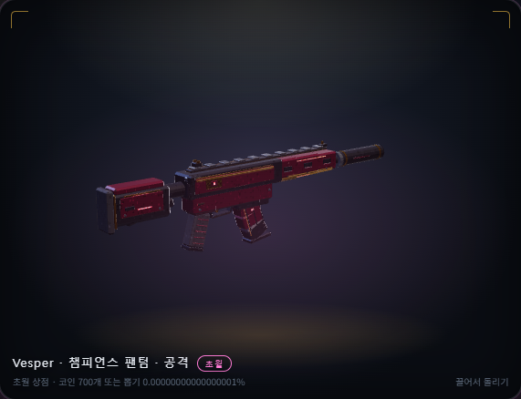
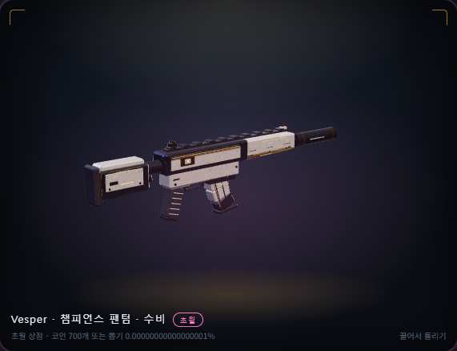
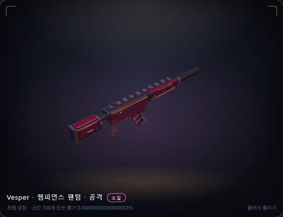
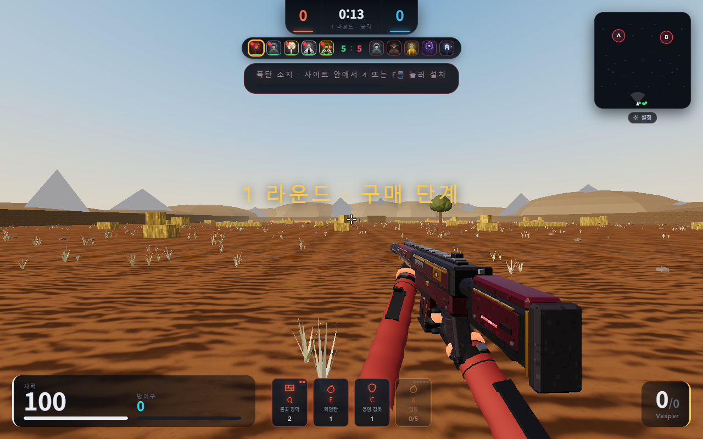

# 챔스 입체 소총 재설계 결과

기준 main `e0733ac`. Claude의 칼/손 모션·운영자 권한·명칭·HTTPS 변경을 포함한 상태에서 작업했다. 사용자는 총을 실제 소총 같은 입체 디자인으로 다시 제작하고, 모든 작업 전 Claude/Codex 상호 확인 지침을 추가하라고 요청했다. 새 모델은 별도 main 병합 승인 전까지 미배포다.

- 몸통과 개머리판을 닫힌 입체 형태로 만들고, 베벨·곡선 탄창·원형 소음기와 실제 구멍을 넣었다. 큰 금색 판과 발광선을 줄이고 두 변형의 색을 유지했다.
- 자체 124부품, 실제 렌더 정점 14172개, 17개 본/피벗 유지. 예전 4752정점보다 많으므로 실기기 성능이 같다고 주장하지 않는다. 기존 뼈대별 병합 방식과 15000정점 제한을 유지한다.
- 512px 기본·발광·물리 표면 맵으로 금속·코팅·고무의 반응을 구분한다. 물리 표면 맵은 linear data로 읽는다.
- 솔리드에만 반 텍셀 UV 여백과 면 내부 패딩을 적용한다. 검토에서 찾은 알파 빈틈은 실패 검사(2784/132272)로 재현 후 수정했다. 두 변형 모두 내부 샘플 132272개에서 빈틈 0이다. 실제 구멍은 메시로 유지한다.
- RGX 원본의 렌더 정점/법선/UV 해시는 기존 렌더러와 일치한다. 일반 큐브와 다른 칼 모델은 교체하지 않았다. 처치 물결·오디오·배너·마무리·소유/장착 대상·가격/확률을 유지한다.
- 로컬 전체 단위 522 통과, 실제 Redis 선택 검사 2개 제외. 구문·자산 52개 해시/길이·CSP 생성물 일치 검사 통과.
- 브라우저: 두 변형 PC/모바일·표면 맵·정점/프레임·장전/발사·1인칭, 캐시 복구, RGX, 처치 물결 통과. 검토 수정 후 미리보기·로딩 실패/재시도·전체 구매/장착/재접속·떨어진 총 복원 통과.
- 구매/관리자 지급은 메모리 API fixture다. 실제 계정·실결제·실제 휴대폰 하드웨어 검증은 수행하지 않았다.
- 독립 검토 2개에서 발견한 UV 빈틈과 오래된 정점 기대값을 수정했고, 재검토에 남은 지적은 없다. GitHub 회귀 결과는 PR에서 기록한다.

## 실제 렌더

## 공동 작업 지침

`AGENTS.md`·`CLAUDE.md`가 공통 `.cursor/rules/collaboration-coordination.mdc`를 가리킨다. 작업 시작/재개 시 양쪽 도구가 상대의 커밋·PR·worktree 미커밋 변경을 확인하고 `docs/AGENT_WORK_STATUS.md`에 기록한다. 기존 worktree에도 즉시 적용되도록 공유 상위 폴더에 AGENTS/CLAUDE/동일 규칙과 공유 작업 현황을 추가했다. 규칙 추가는 상대 PR의 임의 병합·배포 허가가 아니다.
