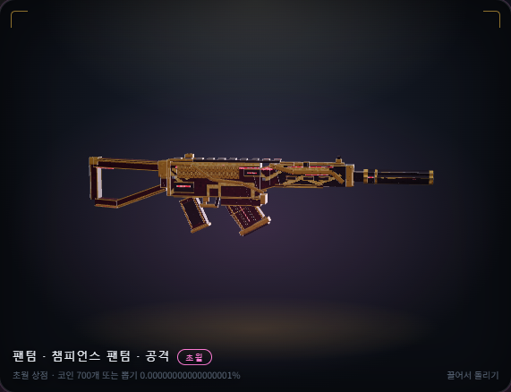
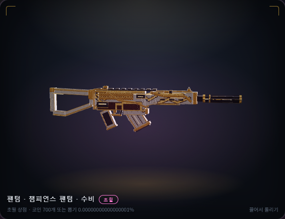
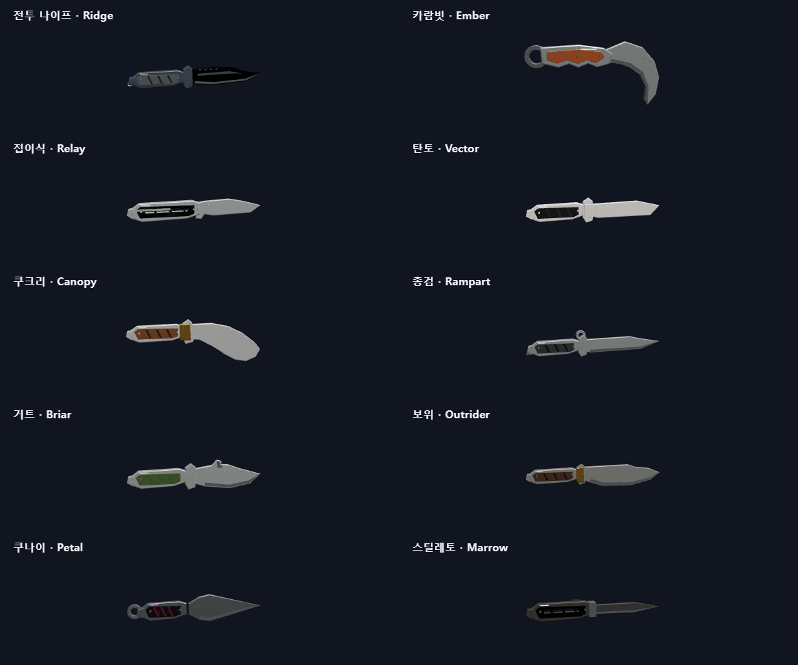
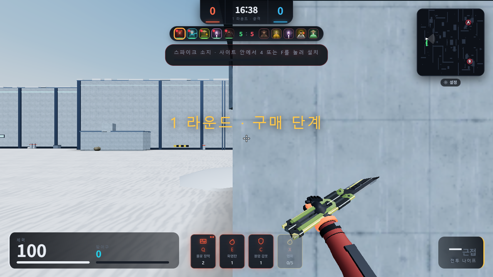

# 스킨 디자인 교정 결과

기준 main: `a55ca9d`. 이번 작업은 챔스 자체 디자인과 RGX 예외를 바로잡는다. 별도 병합 승인 전까지 운영 서비스에는 적용하지 않는다.

## 결과

- 챔스 공격형·수비형은 DFDF 생성기 132개 큐브와 512px 자체 아틀라스를 사용한다. JAR 총 JSON·텍스처 복사 소스는 제거했다. 과거 IndexedDB 모델이 자체 디자인을 덮는 경로와 JAR 업로드 UI도 제거했다. 보유·장착 데이터는 유지한다.
- 칼 10종은 칼날·그립·프레임을 새로 만들었다. 기본, 카람빗, 접이식, 탄토, 쿠크리, 총검, 거트, 보위, 쿠나이, 스틸레토 각각의 형상이 다르다. 기존 손/피벗/모션 부분과 모듈 83은 기록된 해시와 일치한다.
- RGX 11z Firefly 나비칼만 제공된 `future_butterfly`의 모델·텍스처·모션·관련 소리를 선별했다. 11개 파일의 SHA-256을 검증한다. 다른 칼/총 팩은 불러오지 않는다.
- `butterfly` 보유/장착 키는 유지한다. 아직 남아 있는 `vp_future_butterfly` 보유·장착·찜 기록은 현재 키로 이전한다. 이전 배포에서 이미 환불 후 삭제된 보유 기록을 복원했다고 주장하지 않는다.
- RGX 원본 손 소켓을 게임의 기존 손 위치에 맞췄다. 검토 중 발견한 세 번째 공격 잘림, 재장착 시 꺼내기 누락, inspect의 pre/post 경계 회전, 오디오 resume 뒤 취소 누락을 재현 검사 후 수정했다.

## 로컬 검증

- 전체 단위: main의 능력 조준 수정 #121을 통합한 뒤 512개 중 510개 통과, 실제 Redis가 필요한 선택 검사 2개 건너뜀, 실패 0.
- 구문 검사: 외부 스크립트 207개 및 HTML 내 스크립트 통과. 패키지 자산 50개 해시/길이와 CSP 생성물 일치 확인.
- 브라우저: 자체 챔스 기본/캐시 복구, 공격형·수비형, 모델 로딩 실패/재시도, 처치 물결, 모션, 음악·소리, 8초 마무리, 구매/장착/재접속/떨어진 총 복원 통과.
- 칼: 자체 10종 손/피벗/모션/정확한 원위치 복귀 통과. RGX PC·휴대폰 크기 미리보기, 원본 180큐브와 텍스처, 손 소켓, inspect 6.5초, 캐시된 무기 재장착, 세 번째 공격 3초 유지·복귀 통과.
- RGX 손 소켓 간격 약 `3.2e-14`, inspect 이후 각도 차이 `0`. 변형·유한 정점 검사를 함께 수행했다.
- 테스트 계정·구매는 메모리 API fixture를 사용한다. 실결제 검증이 아니다. Android 실기기·실제 휴대폰 성능·실제 인터넷 대전 검증은 수행하지 않았다. 휴대폰 크기 및 챔스 모바일 컨텍스트 검사를 실기기 결과로 해석하지 않는다.

## 실제 렌더 화면

테스트 fixture의 실제 게임 모델과 재질로 렌더했다. 제품 외형을 수정하는 합성 이미지는 사용하지 않았다.

## 공동 작업

최종 확인 중 main에 PR #121이 병합되어 `69e8f67`로 바뀌었다. 이 능력 조준 수정을 브랜치에 통합했고, 충돌은 없었다. Claude의 PR #120은 손/칼 모션을 별도로 변경하므로 이번 PR의 '모션 유지' 기준에는 포함하지 않았다. 승인 후 함께 반영한다면 모션 파일 충돌과 RGX 어댑터를 재검증해야 한다. PR #119, #122, #123도 열린 상태였으며 이 작업에서 임의 병합하지 않았다.
